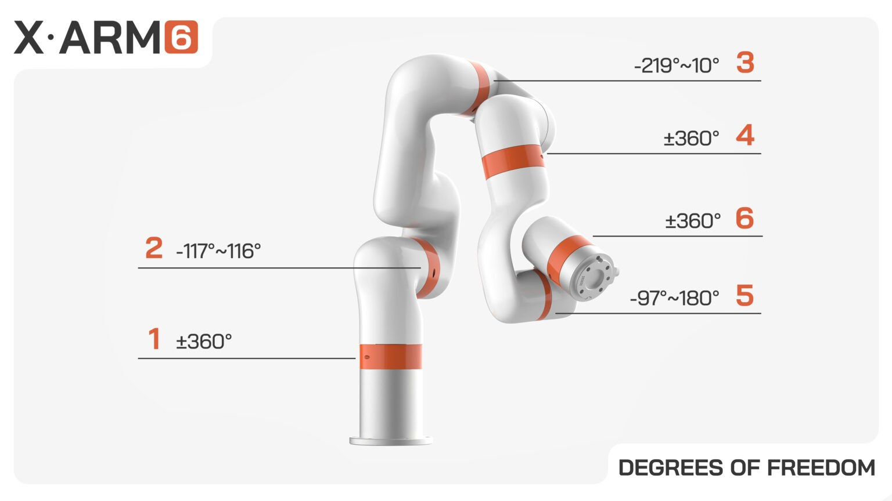
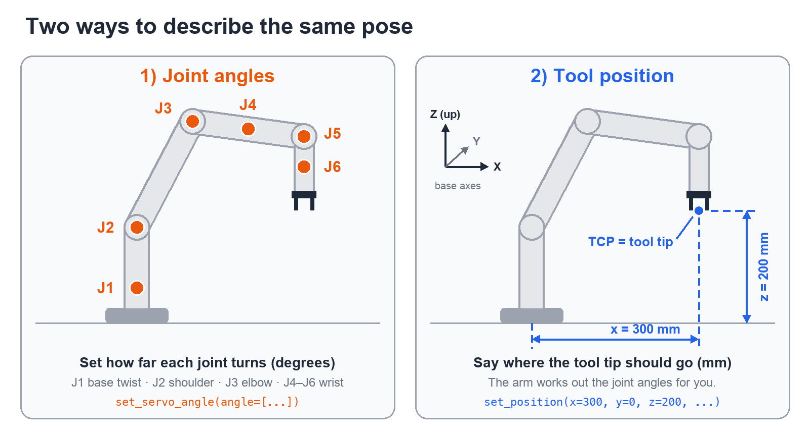
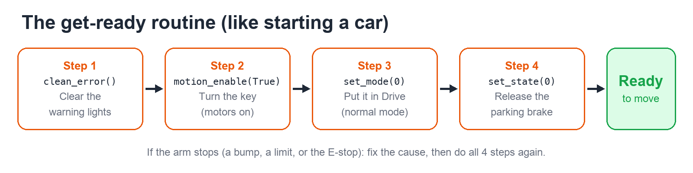
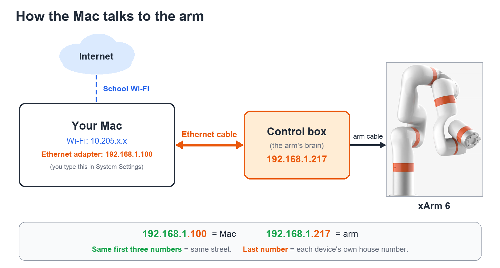
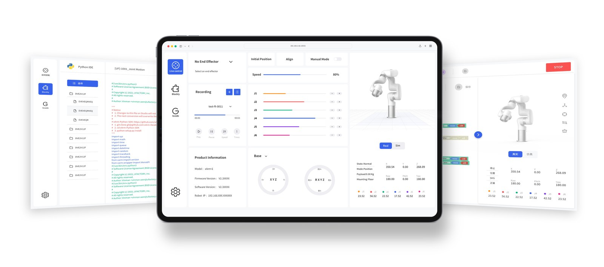

# Lesson 1: The Core 20% of the xArm 6

Five ideas that get you most of the way. Learn these first; everything else can wait.

---

## Core idea 1: Safety comes before code
The xArm 6 is strong and fast enough to hurt someone or break things.
- **E-stop (emergency stop):** the big red button. Press it and the arm stops right away. Keep a hand near it whenever new code runs.
- **Clear the workspace:** nothing and nobody within the arm's reach.
- **Go slow first:** run new moves at low speed (like 50 mm/s). Speed up only after it does what you expect.

## Core idea 2: There are two ways to say where the arm is

*The xArm 6's six joints and how far each one can turn. Image: UFactory.*

Think about your own arm:
- **Joint angles:** "Shoulder at 30°, elbow at 90°…" The xArm has 6 joints, **J1 to J6** (base to wrist).
- **Tool position (Cartesian):** "My hand is 30 cm in front of me and 20 cm up." For the arm that's **x, y, z** in **mm**, plus three tilt angles **roll, pitch, yaw** in **degrees**.

Both describe the same pose. Usually you care where the **hand** goes, so you'll mostly use tool position.
The "hand" point is called the **TCP** (Tool Center Point): the tip of whatever tool is attached.



## Core idea 3: Every program starts with the "get ready" routine
Like starting a car:



```python
arm.clean_error()
arm.motion_enable(True)
arm.set_mode(0)
arm.set_state(0)
```

**If the arm stops on its own** (it bumped something, hit a limit, or the E-stop was pressed), it goes into an error state. Fix the cause, then **run the get-ready routine again.**

## Core idea 4: Two move commands do almost everything
```python
# Move the HAND to a spot (mm and degrees)
arm.set_position(x=300, y=0, z=200, roll=180, pitch=0, yaw=0, speed=50, wait=True)

# Move each JOINT to an angle (degrees, J1..J6)
arm.set_servo_angle(angle=[0, 0, 0, 0, 0, 0], speed=20, wait=True)
```
Three options you'll use all the time:
- `speed=`: how fast. Start slow.
- `wait=True`: finish this move before running the next line. Without it, moves pile up.
- `relative=True`: move *this much from where you are* (for example, `z=50` means 50 mm up), instead of *go to this exact spot*.

Every command returns a **code**. **0 means OK**; any other number means something went wrong.

## Core idea 5: Connect over Ethernet using an IP address
The Mac talks to the **control box** (not to the arm directly) over an Ethernet cable.



1. Find the arm's IP address on the label on the control box. **Ours is `192.168.1.217`.**
2. Plug an Ethernet cable from the control box into your Mac. MacBooks have no Ethernet port, so use a **USB-C to Ethernet adapter**.
3. Give your Mac a matching address. Go to **System Settings → Network → (your Ethernet/USB-C adapter) → Details → TCP/IP**, set **Configure IPv4: Manually**, and enter:
   - IP address: `192.168.1.100` (same first three numbers as the arm, different last number)
   - Subnet mask: `255.255.255.0`
   - Router: leave blank
4. Test it: open `http://192.168.1.217:18333` in a browser. That's **UFactory Studio**, the arm's built-in control website. If it loads, you're connected.

Wi-Fi can stay on. Wi-Fi gives you the internet, and the cable reaches the arm. They use different addresses (school Wi-Fi is `10.205.x.x`), so they don't conflict.


*This is what UFactory Studio looks like. If this loads in your browser, the connection works. Image: UFactory.*

---

## Your first two programs
Both are in `code/`. Use them in this order:

| Script | What it does | Moves the arm? |
|---|---|---|
| `01_hello_arm.py` | Connects and prints joint angles and tool position | **No** (safe) |
| `02_first_move.py` | Lifts the hand 50 mm up and back down, slowly | Yes |

To run them, open Terminal, go to the week's code folder, and use the xArm Python:
```bash
source ~/venvs/xarm/bin/activate
python 01_hello_arm.py
```
(The scripts already know our arm's IP, `192.168.1.217`.)

---

## Mac setup (already done)
- **SDK** (Software Development Kit, the Python library that talks to the arm): `xarm-python-sdk` version 1.18.4.
- Installed in a **virtual environment** at `~/venvs/xarm`. A virtual environment is a private Python setup just for this project, so it can't break your other Python projects.
- It's kept **outside OneDrive** on purpose. It contains thousands of small files, and OneDrive would try to sync them all.
- To reinstall on another Mac:
  ```bash
  python3 -m venv ~/venvs/xarm
  ~/venvs/xarm/bin/pip install xarm-python-sdk
  ```

---

## Do we need ROS 2?
**Short answer: not now.** Learn the Python SDK first.

**What ROS 2 is:** ROS 2 means "Robot Operating System 2," but it isn't really an operating system. It's a **messaging system plus a toolbox** for robots. A big robot project is split into small programs called **nodes**, and they talk by posting messages on channels called **topics**, like a group chat:
- A camera node posts: "I see a cup at (x, y)."
- A planning node reads that and posts a path to reach it without hitting anything.
- The arm driver node reads the path and moves the arm.

ROS 2 also includes powerful tools:
- **RViz:** a 3D view of the robot on screen
- **MoveIt:** automatically plans paths around obstacles
- **Gazebo:** a physics simulator, so you can test without the real arm

UFactory makes a ROS 2 package for the xArm, called `xarm_ros2`. It supports the ROS 2 versions **Humble** (Ubuntu 22.04) and **Jazzy** (Ubuntu 24.04).

| Use the **Python SDK** when… | Consider **ROS 2** when… |
|---|---|
| Moving to points you choose | A camera has to find objects for the arm |
| Pick-and-place with a gripper | The arm must plan paths around obstacles by itself |
| Drawing or writing, repeated tasks | You want to simulate before using the real arm |
| Learning how the arm works | You're combining many sensors or robots |

**The Mac catch:** ROS 2 is built for **Ubuntu Linux**. To use it on a Mac you'd need to run Ubuntu inside a virtual machine (for example, UTM on Apple Silicon) or in Docker, which takes real setup time.

**80/20 verdict:** The SDK gives you about 80% of what a club project needs with about 20% of the setup. Come back to ROS 2 when a project actually needs vision and automatic path planning.

---

## Extra (optional)
- **Blockly in UFactory Studio:** drag-and-drop programming in the browser. Good for quick tests and for new club members.
- **Manual mode (teach mode):** lets you push the arm by hand and record positions. It's `set_mode(2)` in code. We'll cover it later.
- **Official examples:** github.com/xArm-Developer/xArm-Python-SDK (look in `example/wrapper/`).

## Check yourself
1. What are the 4 lines of the get-ready routine, in order?
2. What's the difference between `set_position` and `set_servo_angle`?
3. What does `wait=True` do?
4. The arm bumped a box and stopped. What do you do next?
