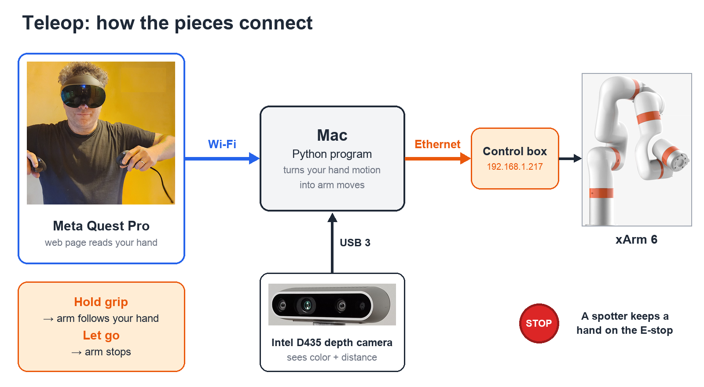
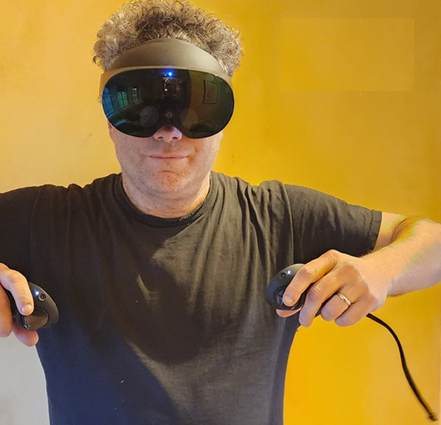
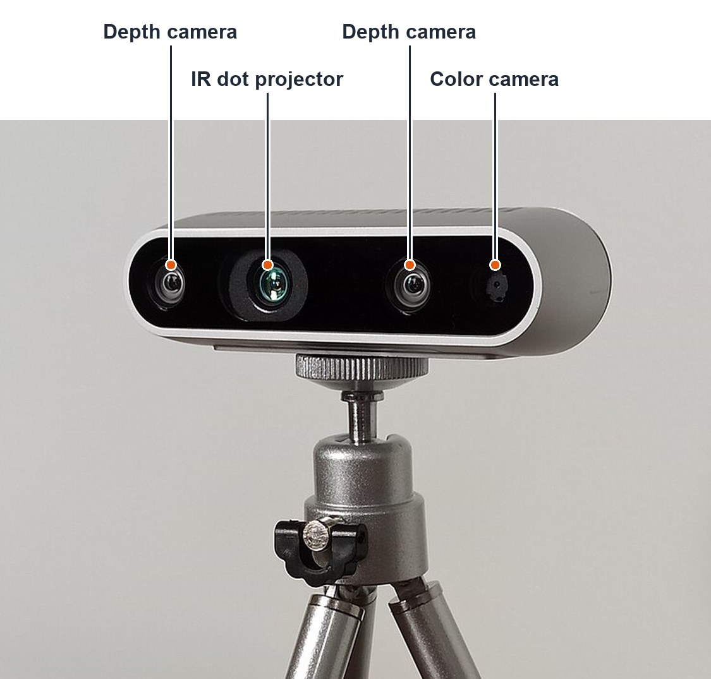

# Lesson 2: Meta Quest Pro Setup Manual (for Teleop)

**Teleop** (teleoperation) means you move your hand and the robot arm copies you.
This manual gets the Quest Pro ready, step by step. Parts A–C need no programming.



**Status:** Parts A–D are ready to do. Part E is the part we still have to build (Phase 1).

> **Update 2026-10-25:** school Wi-Fi doesn't work for this, so we switched to a **Link cable** to the Windows PC. Parts B and E are replaced by the [VR Teleop Manual (Lesson 5)](Lesson05_VR_Teleop_Manual.md).

## Meet the gear

*Meta Quest Pro: the headset plus two controllers. Its front cameras show you the real room (passthrough). Photo: Interweb8888, CC BY-SA 4.0, via Wikimedia Commons (cropped).*


*Intel RealSense D435. The two depth cameras work like your two eyes: each sees from a slightly different spot, and the camera uses the difference to calculate distance. The dot projector sprays an invisible pattern so even plain walls have something to measure. Photo: Marc Auledas, CC BY-SA 4.0, via Wikimedia Commons (cropped, labels added).*

---

## Part A: Set up the headset (one time, about 30 minutes)
Meta's official guide: [Meta Quest Pro initial setup](https://www.meta.com/help/quest/869053370725118/).
The short version:
1. **Charge** the headset and both controllers on the charging dock.
2. On a phone, install the **Meta Horizon** app and sign in with a Meta account. You need a phone only for this first setup.
3. Put on the headset and follow the **fit and focus** steps it shows you.
4. Take the headset off. In the Meta Horizon app, go to **Menu → Devices → Connect new device → Meta Quest Pro** and follow the steps.
5. Connect the headset to **Wi-Fi** and let it **update** completely. Updates can take a while.
6. Set the **boundary**. For robot work, choose **Stationary** (stand in one spot), and stand **outside the arm's reach**.

If pairing fails, the phone and headset must be on the **same Wi-Fi**. See Meta's [setup troubleshooting](https://www.meta.com/help/quest/3148371802120433/) page.

---

## Part B: Make sure the Quest can "talk" to the Mac (5 minutes)
The Quest sends your hand position to the Mac over Wi-Fi. **School networks often block devices from talking to each other**, so test this first.

1. Connect the Mac and the Quest to the **same Wi-Fi**.
2. Find the Mac's Wi-Fi address: **System Settings → Wi-Fi → Details → TCP/IP → IP address**. It looks like `10.205.x.x` at school.
3. On the Mac, open Terminal, go to any folder, and run a tiny test web server:
   ```bash
   python3 -m http.server 8000
   ```
4. In the Quest, open the **Browser** app and go to `http://<Mac's Wi-Fi IP>:8000`.
   - **A file list shows up:** the network works. 🎉
   - **It spins and then fails:** the school Wi-Fi is blocking it. The fix is a small **Wi-Fi router just for the robot lab**, joined by the Mac and the Quest. Ask your club advisor or school IT.
5. Press `Ctrl + C` in Terminal to stop the test server.

---

## Part C: Check that the Quest's browser can do VR (5 minutes)
Our teleop app will be a **WebXR** web page. WebXR is the feature that lets a web page use VR and your controllers. Let's prove it works before we build anything.

1. In the Quest Browser, open: `https://immersive-web.github.io/webxr-samples/`
2. Try an **immersive VR** sample. You should see a 3D scene and your controllers.
3. Try an **immersive AR** sample. You should see **your real room** (called **passthrough**) with 3D objects on top. That's how you'll watch the real arm while you control it.

If both work, the Quest is ready for our teleop app.

---

## Part D: Developer mode (optional, needs an adult)
**You don't need this for our plan.** The WebXR path in Parts B–C works without it.
Developer mode is only for installing custom apps or connecting the Quest to the Mac by USB cable.
- Meta requires the account holder to be **18 or older**, a member of a developer team, and verified. So a **club advisor or parent** would have to set it up.
- Meta's guide: [Set up your device for development](https://developers.meta.com/horizon/documentation/native/android/mobile-device-setup-quest/).

---

## Part E: Running teleop (Phase 1, still to be built)
This is how it *will* work once we write the code:
1. On the Mac, start the teleop program. It also makes a small homemade security certificate, because WebXR only runs on secure (`https://`) pages.
2. In the Quest Browser, open `https://<Mac's IP>:<port>`.
3. The browser warns "connection not private." That warning appears because the certificate is homemade. Choose **Advanced → Proceed**. You only need to do this once.
4. Press **Enter AR**. You'll see the room through passthrough.
5. **Hold the grip button** and the arm follows your hand. **Let go** and the arm stops.

### Phase plan (80/20)
| Phase | What happens |
|---|---|
| **1** | Hold grip and the arm copies your hand's *position* (not rotation yet) |
| 2 | Add hand rotation, and the trigger works the gripper |
| 3 | Stream the D435 camera into the headset |
| 4 | Record demonstrations to train an AI model (see Lesson 3) |

---

## Teleop safety checklist (every session)
- [ ] **Two people:** the operator wears the headset, and a **spotter keeps a hand on the E-stop**. The operator can't reach the E-stop reliably.
- [ ] The operator stands **outside the arm's reach** and uses passthrough to see the room.
- [ ] The **speed limit** and **safety box** are turned on in the code. These are the xArm's "reduced mode" and "fence mode."
- [ ] The first test of every session uses **slow speed and small motions**.
- [ ] Everyone knows: **let go of grip = arm stops**.

## Check yourself
1. Why do we test the network (Part B) before anything else?
2. What is passthrough, and why is it useful for teleop?
3. Why does the operator need a spotter?
