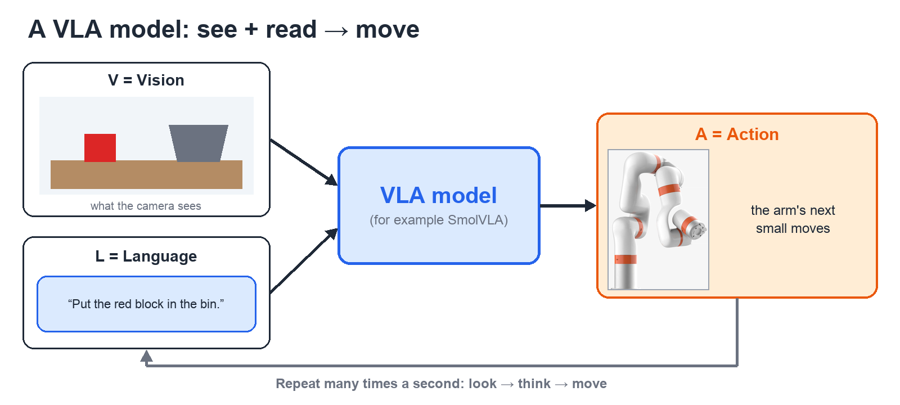
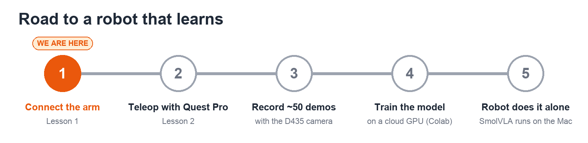

# Lesson 3: VLA Models (Teaching the Arm with AI)

## Core idea 1: What a VLA is
**VLA = Vision-Language-Action.** It's an AI model that:
- **sees** through a camera (Vision),
- **reads** an instruction like *"put the red block in the bin"* (Language),
- and **outputs the arm's next moves** (Action), many times per second.

Think of a chatbot whose answer is arm motion instead of words.

## Core idea 2: It learns by watching you
A VLA doesn't know *your* arm, camera, or table out of the box. You **fine-tune** it, which means teaching it with your own examples:
1. **Demonstrate** the task with teleop (Lesson 2). One full try from start to finish is called an **episode**. The computer records the camera video, the arm's positions, and the instruction text.
2. **Train:** the model studies your episodes.
3. **Run:** the model does the task by itself.

It's like learning to drive. You watch an instructor many times, then you drive.

**How many demos?** Hugging Face recommends about **50 episodes** for one task to start. In their test, they used 5 block positions × 10 demos each. **25 episodes wasn't enough.** Variety matters: repeat each variation several times.

**So teleop and the D435 aren't side projects. They're how you collect the training data.**

## Core idea 3: Can our setup run one? Yes, with one catch
Our Mac is an **M1 Max with 64 GB** of memory.

| Job | Where | Notes |
|---|---|---|
| **Run** a small VLA (SmolVLA, 450 million parameters) | ✅ Our Mac | Small enough for a laptop |
| **Train / fine-tune** it | ☁️ Cloud GPU (Google Colab) | About 4 hours on a big NVIDIA GPU. Possible on a Mac, but much slower. |
| Bigger VLAs (OpenVLA, π0) | NVIDIA GPU machines | Extra (optional): not the 20% path |

**The catch:** the arm must be connected first (Lesson 1), and teleop must work (Lesson 2). A VLA is the last step, not the first.

## The roadmap

## Tools we'd use
- **LeRobot:** Hugging Face's free toolkit that records demos, trains, and runs models. It works with SmolVLA.
- **SmolVLA:** a small VLA built to be fine-tuned on hobby and school setups.
- **`lerobot-robot-xarm`:** a community plugin that connects LeRobot to xArm arms. **But it was made for the smaller xArm Lite 6.** To use it on our xArm 6 we'd change three things:
  1. the arm model file it uses to calculate joint angles (the Lite 6's is built in),
  2. the IP address (its code always uses `192.168.1.184`, and ours is `192.168.1.217`),
  3. the gripper code (it's written for the Lite 6 gripper).

## What you can do *today* without the arm
- Watch real training data: open the SmolVLA example dataset in the [LeRobot dataset viewer](https://huggingface.co/spaces/lerobot/visualize_dataset?path=%2Flerobot%2Fsvla_so100_pickplace%2Fepisode_0) and see what an episode looks like.
- Set up the Quest Pro (Lesson 2, Parts A–C).
- Get the D435 camera working on the Mac.

## Extra (optional)
- SmolVLA predicts a **chunk** of future moves at once, not one move at a time. That keeps the motion smooth.
- Training on the Mac is possible with community tools such as `mlx-smolvla`, but it's a "preview" and takes many hours.

## Check yourself
1. What do V, L, and A stand for, and what does each one do?
2. What is an episode?
3. Why do we need teleop before we can use a VLA?
4. Which part runs on our Mac, and which part should run in the cloud?
