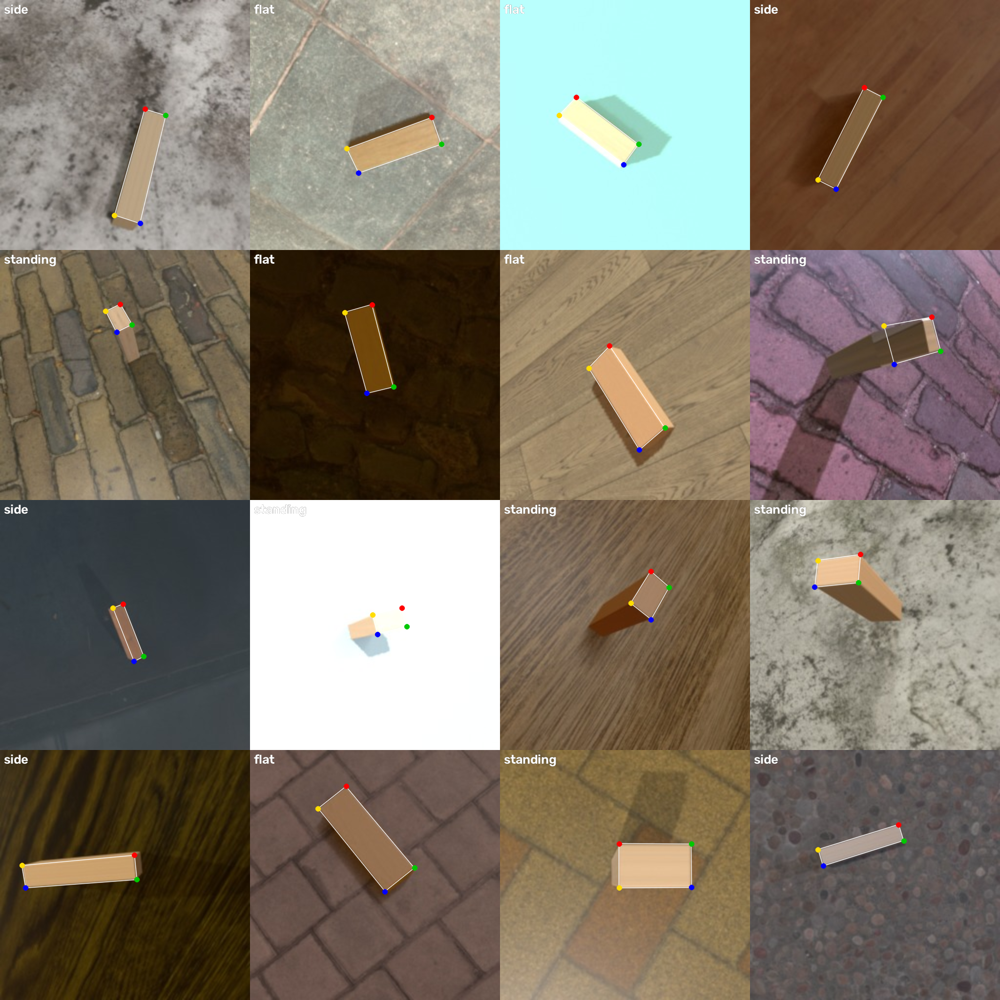
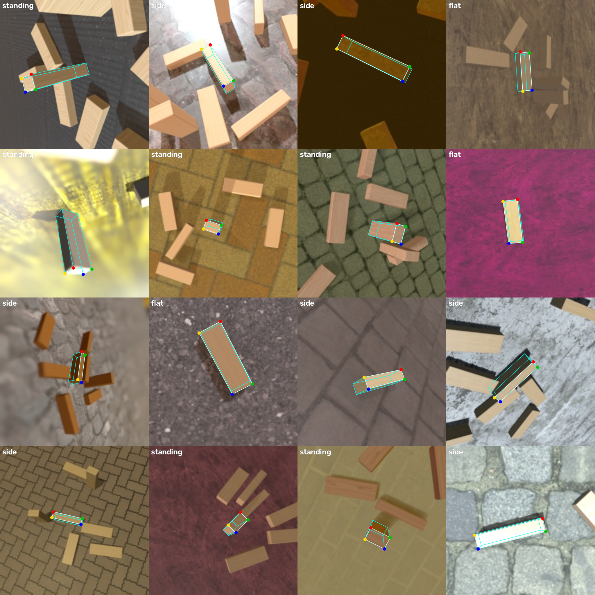
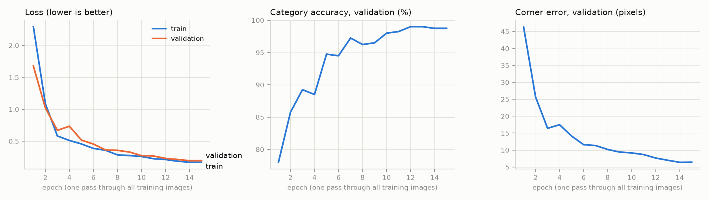
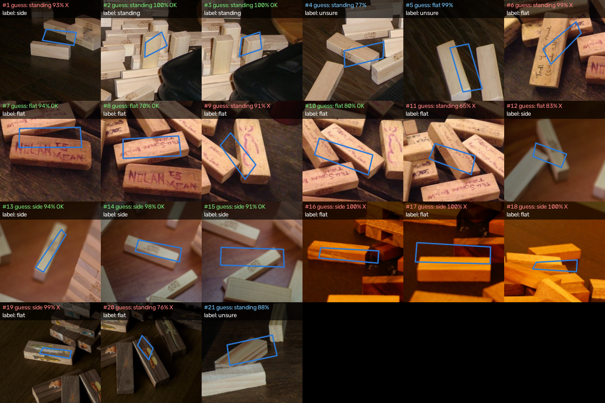
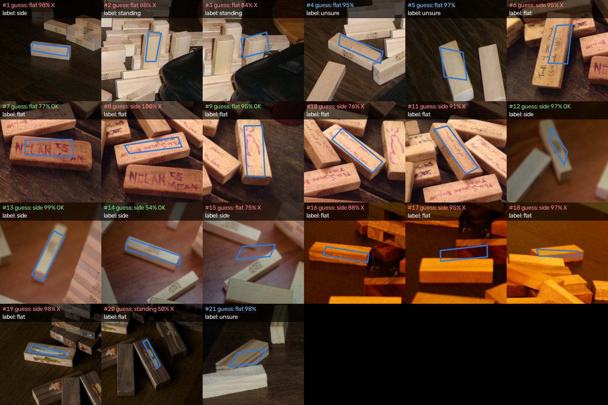
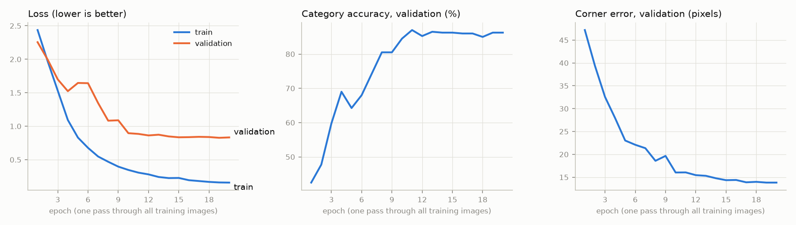
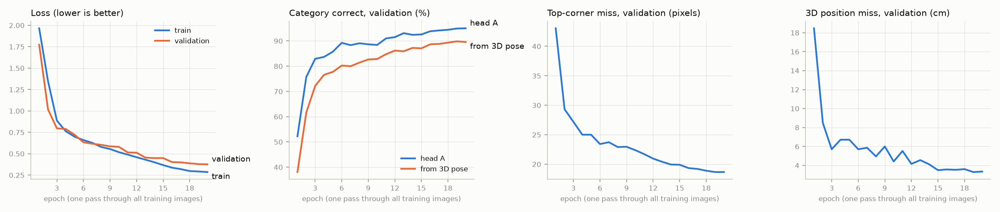
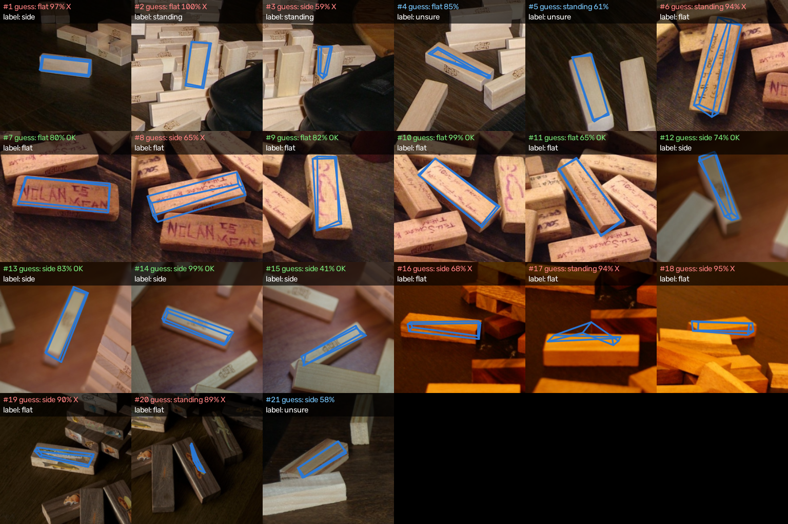

# Lesson 4: Teaching a CNN to See Jenga Blocks

**Goal:** show the computer one photo of a Jenga block. It answers two questions:
1. Is the block **flat**, on its **side**, or **standing**?
2. Where are the **4 corners of its top face**? (8 numbers: x1, y1 … x4, y4)

From the 4 corners we work out the block's **center, angle, length, and width**. That's what a robot arm needs to pick it up.

We had no hardware this week, so every training picture was **made in Blender**. Then we tested on **real photos** from the internet, and that test changed the plan (see "The real-photo test").

## Core idea 1: A CNN is a stack of pattern detectors
**CNN = Convolutional Neural Network.** It slides thousands of tiny "stencils" (called **filters**) across the picture. Each stencil checks one small patch at a time for one pattern.

- **Layer 1** finds simple things: edges, lines, color changes.
- **Layer 2** combines edges into corners and textures.
- **Layers 3–4** combine those into shapes, then whole-block patterns.

Think of a team of inspectors: the first row only spots lines, and each row behind them builds bigger ideas from what the row in front reports.

**ResNet-18** is a famous CNN with 18 layers. You can click its neurons in our web page (below) and see what each one reacts to.

## Core idea 2: Don't start from scratch (transfer learning)
Training a CNN from zero needs millions of pictures. Instead we start from a ResNet-18 that someone already trained on **1.2 million photos** (the ImageNet dataset). It already knows how to see edges, textures, and shapes. We only teach it what a Jenga block is.

It's like hiring someone who can already see and teaching them one new job. This step is called **fine-tuning**.

## Core idea 3: One body, two heads
```
photo → ResNet-18 body → 512 numbers ("features") ─┬→ head A: 3 scores (flat / side / standing)
                                                   └→ head B: 8 numbers (4 corners x, y)
```
- The **body** turns a picture into 512 numbers that describe it.
- Each **head** is one small layer that reads those 512 numbers and answers its own question.
- Training scores both answers at once: **total loss = category loss + 10 × corner loss.** "Loss" means how wrong the network is. Training nudges every weight a little to make the loss smaller, thousands of times.

## Core idea 4: Fake photos with perfect labels
Blender ([02_render_blender.py](code/jenga_cnn/02_render_blender.py)) builds a 7.5 × 2.5 × 1.5 cm block, then randomizes **everything** for each picture:
the face that's up (that's the category), spin, position, camera height and tilt, zoom, wood texture, table texture, room lighting, and sun.

Because Blender placed the block, it knows exactly where the 4 top corners land in the picture. **The labels are perfect and free: nobody clicks anything.**

**Version 2** also scatters up to 8 neighbor blocks around the target, because real photos are crowded. The label is always the **middle** block.
**Version 3** also saves all 8 box corners and the block's exact 3D position and rotation.

We always check labels by eye before training ([03_check_labels.py](code/jenga_cnn/03_check_labels.py)). Version 1 (one block) is on the left, version 3 (crowded, with the 3D box) on the right:

 

## Core idea 5: Two traps we avoided
| Trap | What goes wrong | Our fix |
|---|---|---|
| **Corner order** | A rectangle has no "first" corner. Turn it 180° and it looks the same. If "corner 1" means top-left in one picture and bottom-right in a nearly identical one, the network learns to guess the middle. | The loss tries all 4 starting corners and keeps the best match. In version 3, a whole block looks the same after a 180° turn around any of its 3 axes, so the loss tries those 4 corner orders (`box_loss` in [jenga_model.py](code/jenga_cnn/jenga_model.py)). |
| **Sim-to-real gap** | A network trained only on fake pictures can fail on real photos. | **Domain randomization:** random wood, tables, lighting, blur, color, and noise, so a real photo looks like "just another variation." Real photos are still the final test. |

## Core idea 6: Overfitting = memorizing instead of learning
If the **training** loss keeps falling but the **validation** loss (pictures it doesn't train on) stops improving, the network is memorizing its practice pictures. It's like memorizing the answers to one practice test: you ace that test and fail the real one. **Fixes:** more and more varied pictures, stronger random changes (augmentation), or a simpler task.

## Version 1 results (one block per picture)
We trained for 15 epochs (passes through the data) on 3,200 rendered pictures. That took about 10 minutes on the M1 Max's GPU. The final test used **400 rendered pictures the network never saw**:

| Measure | Result | Target |
|---|---|---|
| Category correct | **98.3%** (393 of 400) | ≥ 95% ✅ |
| Corner miss (average) | **6.0 px** on a 256 px picture | about 5 px (close) |
| Angle miss (average) | **7.8°** | about 3° ❌ (see below) |
| Length / width miss | 4.9 / 2.7 px | |



**Where the errors come from:**

| Category | Corner miss | Angle miss (average) |
|---|---|---|
| Flat | 4.7 px | 2.5° ✅ |
| Side | 4.3 px | 1.8° ✅ |
| Standing | 8.9 px | 18.4° ❌ |

- **Flat and side blocks already meet the targets.**
- **Standing blocks are the weak spot.** Their top face is small (2.5 × 1.5 cm) and almost square, so a few pixels of corner error can swap which edge looks "long", and then the angle is off by up to 90°.
- **Mix-ups:** 3 flat blocks were called side and 3 side blocks were called flat. One standing block was called flat. Side and standing were never confused.

## The real-photo test
1. We searched Openverse (millions of Creative Commons photos) for "Jenga" and downloaded **394 photos** ([07_get_real_photos.py](code/jenga_cnn/07_get_real_photos.py)). Most showed towers or people. Only 6 showed loose blocks we could crop.
2. From those 6 we made **21 crops**, each centered on one block ([real_crops.csv](code/jenga_cnn/real_crops.csv)). A person wrote down each block's category **before** running the network. Three were marked "unsure".
3. Real photos have no exact corner labels, so we graded each blue outline **by eye**: good (on the middle block's top face), rough (right block, but wrong size, face, or position), or wrong (a different block).
4. [08_test_real.py](code/jenga_cnn/08_test_real.py) runs the test. Photo credits are in [media/CREDITS.md](media/CREDITS.md).

**Version 1 did badly:** 8 of 18 categories right, and the corners were good on only 7 of 21. The big reason: **real photos have many blocks**, and version 1 had only ever seen one block alone. In crowded crops it outlined a neighbor or got confused by the extra edges. Real photos also had steeper camera angles (45–60° vs. our 0–35°) and darker wood.



## Version 2: train on crowded scenes
We changed the renderer to match what real photos show: **up to 8 neighbor blocks**, camera tilt up to **60°**, **dark wood** in 30% of pictures, and **focus blur** in 35%. We trained 20 epochs instead of 15.

| Measure | Version 1 | Version 2 |
|---|---|---|
| Real photos: category right (18 labeled) | 8 (44%) | 5 (28%) |
| Real photos: corners good / rough / wrong (21) | 7 / 12 / 2 | **12 / 9 / 0** |
| Blender test: category right | 98.3% | 85.0% |
| Blender test: corner miss | 6.0 px | 15.1 px |



**What we learned:**
- **Training with neighbors worked for corners.** Version 2 finds the middle block in every crop and outlines its top face well in 12 of 21. Version 1 managed 7.
- **Flat vs. side got worse.** From a steep angle, a flat block and a block on its side look alike, even to people. Some of our own real-photo labels may be wrong, especially for the dark-wood photo. With only 18 labeled crops, a couple of mistakes swing the score a lot.
- **Version 2 overfit** (Core idea 6). Its training loss reached 0.16 while validation loss stalled near 0.83. 3,200 pictures were enough for lone blocks but not for crowded scenes.



## Version 3: more data, heat maps, and the 3D pose (PnP)
Version 3 made four changes. Each one fixed a problem we could see.

**1. 3× more pictures, plus random turns and mirrors (fixes overfitting).** We rendered 12,000 crowded scenes instead of 4,000. During training, each picture is also turned 0/90/180/270° and maybe mirrored, with the corner labels moving exactly with it. We added two small brakes on memorizing: **dropout** (randomly hide 20% of the features on each training step) and stronger **weight decay** (gently pull every weight toward zero). The training/validation loss gap shrank from about 0.67 to about 0.09.

**2. Heat maps instead of 8 plain numbers (fixes blurry corners).** ResNet's last step averages each 7 × 7 map into one number. That throws away most of the *where* information, and then we asked for exact corner positions. Now head B "zooms back up" to a 56 × 56 grid and paints one **heat map per corner**. Each corner is the *average spot of its heat*, weighted by how hot each square is (called **soft-argmax**). We also add two "where am I" channels (x and y position), so "the block in the middle" is easy to find.
- Our first try picked the 4 hottest spots instead. When two corners' blobs merged, it grabbed empty squares, and the outlines shot off to the picture's edges. Soft-argmax always gives exactly one point per map.

**3. All 8 box corners, then PnP (gives the 3D pose).** Head B finds all 8 corners of the block's 3D box (even the 1–3 hidden underneath). **PnP** (Perspective-n-Point, `cv2.solvePnP`) takes those 8 corners, the block's real size (7.5 × 2.5 × 1.5 cm), and the camera's lens setting, and works out where the block is in 3D (cm) and how it's turned.
- When a training picture is mirrored, the corner numbers must be swapped end-for-end. Otherwise the corners describe a mirror-image block that no real block can match. We checked this: PnP fits every turned or mirrored example within 0.007 px.

**4. Use what you know: the block lies on the table.** Plain PnP allows any 3D rotation. But a block on a table can only rest on one of its 3 face types and **spin**. Since we know which way is up, `solve_pose_on_table` tries each face × every spin angle (in 2° steps), works out the position for each with simple linear algebra, and keeps the best fit. Fewer things to guess = less room for error.

**Results on 1,200 Blender test pictures** (the network never saw them):

| Measure | Version 2 | Version 3 |
|---|---|---|
| Category right (head A) | 85.0% | **94.4%** |
| Top-corner miss | 15.1 px | **9.0 px** |
| 3D position miss (median / average) | none | **0.95 cm** / 1.9 cm |
| 3D rotation miss, plain PnP (median) | none | 25.5° |
| 3D rotation miss, PnP on the table (median) | none | **3.7°** |



**Does the category "fall out for free" from the 3D pose?** In theory yes: whichever block edge points up tells you flat, side, or standing. In practice, with our corners, **no**. Geometry alone was right 89.8% of the time (90–91% with plain PnP), but head A was right **94.4%**. The block's short edges (1.5 and 2.5 cm) are only 12–25 px tall in these pictures, so a 9 px corner miss blurs exactly the difference between flat and side. Combining both clues didn't beat head A either. **So each part does what it's best at: head A picks the face, and PnP on the table finds the spin and position.**

**Real photos:** head A got 8 of 18 categories right (like version 1). In 19 of 21 crops the 3D box lands on the middle block and lines up with its length (graded by eye). But on most real photos the box comes out **squashed flat**: the network barely separates the top corners from the bottom ones on real wood.



**What we learned:**
- **Look at the failures before changing anything.** The heat-map version first looked worse (35 px). Drawing its heat maps showed the maps were fine and the corner picker was broken.
- **Add what you know about the world.** "The block lies on the table" cut the rotation miss from 25.5° to 3.7° without retraining.
- **A math step is only as good as its inputs.** PnP is exact with perfect corners (0.002 cm), but our corners aren't precise enough on the short edges to read flat vs. side.

**Next steps (the 20% that matters):**
1. **Photograph our own blocks with our D435,** looking down from the arm. The D435's depth reading can also check the PnP distance.
2. On the robot, "up" comes from the arm's joint angles, and the lens setting from the D435. Then `solve_pose_on_table` gives the grab position and spin directly.
3. Hand-label some real photos (or our own D435 pictures) and mix them into training, to un-squash the real-photo boxes.

**The interactive page:** open [media/jenga_net_explorer.html](media/jenga_net_explorer.html) in any browser. It uses the current model (version 3). Pick a Blender or real picture to see the network's 3D box (with the top face shaded), its distance and rotation next to the truth, the corner heat maps, and the picture turning into an idea layer by layer.

## How to run it
All big files (textures, 12,000 images, the trained model) live in `~/arm_data/jenga/`, outside OneDrive.
1. `cd` into `Week01_2026-10-19/code/jenga_cnn`
2. Download textures and lighting (about 50 MB, once):
   `~/venvs/vision/bin/python 01_download_assets.py`
3. Render the pictures (about 30 minutes per 4,000):
   `/Applications/Blender.app/Contents/MacOS/Blender -b -P 02_render_blender.py -- 12000`
   Every picture has its own random seed, so running it again only re-computes the labels (seconds) and renders missing pictures.
4. Check the labels: `~/venvs/vision/bin/python 03_check_labels.py`, then open `media/jenga_label_check.png`
5. Train (about an hour for 12,000 pictures): `~/venvs/vision/bin/python 04_train.py`
   Re-score the saved network without training: `~/venvs/vision/bin/python 04_train.py --test-only`
6. Try any photo: `~/venvs/vision/bin/python 05_predict.py photo.jpg`
   Add `--fov 69` (the D435 color camera's field of view) to also get the block's distance from PnP.
7. Download real test photos (once): `~/venvs/vision/bin/python 07_get_real_photos.py`
8. Run the real-photo test: `~/venvs/vision/bin/python 08_test_real.py`, then open `media/jenga_real_test.png`
9. Rebuild the web page: `~/venvs/vision/bin/python 06_export_viz.py`

Older versions are saved in `~/arm_data/jenga/`: version 1 as `images_v1/`, `labels_v1.csv`, `models/v1/`; version 2's model as `models/v2/`.

## Files
| File | What it does |
|---|---|
| `code/jenga_cnn/01_download_assets.py` | Downloads wood/table textures and room lighting from Poly Haven (CC0: free for any use) |
| `code/jenga_cnn/02_render_blender.py` | Makes the fake photos and `labels.csv` (category, 4 top corners, 8 box corners, 3D pose, lens, "up") |
| `code/jenga_cnn/03_check_labels.py` | Draws labels on 16 pictures so we can check them |
| `code/jenga_cnn/jenga_model.py` | The network (heat-map head B), the corner losses, PnP (plain and on the table), and the corners → center/angle/size math |
| `code/jenga_cnn/04_train.py` | Fine-tunes ResNet-18 and runs the final test, including the 3D pose |
| `code/jenga_cnn/05_predict.py` | Runs the network on any photo and draws its 3D box |
| `code/jenga_cnn/06_export_viz.py` + `viz_template.html` | Builds the interactive web page |
| `code/jenga_cnn/07_get_real_photos.py` | Downloads Creative Commons Jenga photos from Openverse and makes contact sheets for picking |
| `code/jenga_cnn/real_crops.csv` | Which block to crop in each real photo, and the category a person labeled |
| `code/jenga_cnn/08_test_real.py` | Runs the network on the real crops and draws the results |
| `media/jenga_net_explorer.html` | **The interactive page.** Open it in any browser. |
| `media/*_v1.png`, `media/*_v2.png` | Older versions' label check, training curves, and real-photo tests (the unmarked files are version 3) |

## Extra (optional)
- **Fix standing blocks:** move the camera closer for standing blocks, or measure their angle from the tall side faces instead of the tiny top.
- **Check PnP with depth:** PnP already gives centimeters from the known block size. The D435's depth reading is a second, independent measurement to compare against.
- **Many blocks in one picture** (a whole tower) needs a detector first, such as YOLO, to crop each block.
